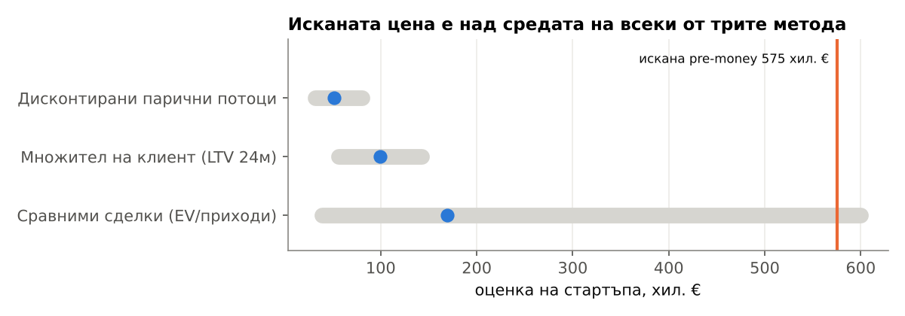

# Оценка на сделка: 50 000 € в стартъп за безвредни спортни облекла (ХИПОТЕТИЧЕН)

*Дата: 30.10.2026 · Нямате данни за конкретен стартъп, затова **всички данни на стартъпа са хипотетични** [ОЦЕНКА]. Пазарните множители и сделки са с източници. Сметки: [analysis/model.py](../analysis/model.py) → [valuation.csv](../analysis/output/valuation.csv), [dcf_flows.csv](../analysis/output/dcf_flows.csv).*

**Присъда: НЕ на исканата цена.** Хипотетичният стартъп иска 50 000 € за 8%, т.е. pre-money оценка €575 000. Средата на трите метода е €99 446, така че исканата цена е 5.8 пъти над нея. **Максимумът, който бих платил, е pre-money ~€100 000**, т.е. около 33% за 50 000 €. Аргументът е, че при тази икономика (−€5.55 на клиент в базовия сценарий) стойността идва от клиентската база и от правото на избор, а не от растежа. Алтернатива на исканата цена е да платим на два транша: втората част се освобождава, когато CAC стане ≤ €31.37 за 3 поредни месеца.

## Данни на стартъпа [ОЦЕНКА, хипотетични]

| Показател | Стойност |
|---|---|
| Приходи за последните 12 мес. | €150 000 |
| EBITDA | −€30 000 |
| Клиенти | 1 800 |
| Искане | €50 000 за 8% → pre-money €575 000 |

## 1. Справедлива стойност по три метода

| Метод | Допускания | Ниска | Средна | Висока |
|---|---|---|---|---|
| **Сравними сделки (EV/приходи)** | Сделки: Allbirds 2026 0.26x, Icebreaker 2018 1.13x, Gymshark 2020 ~4x, Vuori 2024 ~5.5x, Allbirds IPO ~9.9x ([08](../analysis/research/08_sdelki_mnojiteli.md)). Ползваме трите най-ниски, защото стартъпът е малък и губещ | €39 000 | €169 500 | €600 000 |
| **Множител на клиент** | Клиенти × стойност на клиента за 24 мес. (€31.37 базов / €79.12 оптимистичен, [unit_economics.csv](../analysis/output/unit_economics.csv)). EBITDA е отрицателна, затова EV/EBITDA (10.30, Damodaran) не се прилага днес | €56 475 | €99 446 | €142 416 |
| **Дисконтирани парични потоци** | Ръст 60/40/30/20/15% [ОЦЕНКА]; EBITDA марж −20%→11.47% за 5 г. (година 5 = отрасловата медиана на Damodaran); свободен паричен поток ≈ EBITDA [ОЦЕНКА]; крайна стойност = 10.30 × EBITDA в год. 5; дисконт 70/60/50% (рискова доходност за seed 50–70%) | €31 698 | €51 276 | €80 242 |

## 2. Диапазон и къде е исканата цена

| Ниска | Средна | Висока | Искана pre-money |
|---|---|---|---|
| €31 698 | €99 446 | €600 000 | **€575 000**, близо до горния край, достигнат само по сравними сделки при 4x приходите |

## 3. Червени флагове

1. Губещ на клиент в базовия сценарий (−€5.55 за 24 мес.).
2. Отрицателна EBITDA (−€30 000) [хипотетично].
3. CAC в DTC е нараснал с 25–40% за 2021–2025 ([05](../analysis/research/05_kanali_cac.md)).
4. Сравнимата Allbirds е паднала от ~9.9x до ~0.26x приходите.
5. Основното обещание („без PFAS“) става законов минимум през 2026–2027.

## 10 въпроса към продавача

1. Какъв е CAC по канал за последните 6 месеца, по месеци?
2. Какъв е делът на повторните клиенти след 12 и 24 месеца, по кохорти?
3. Какъв е процентът на връщанията и защо се връщат стоките?
4. Каква е себестойността на всеки модел и коя фабрика я произвежда?
5. Какви са минималните поръчки и колко стока има на склад (в € и в месеци продажби)?
6. Кои сертификати са на ваше име и кои са на доставчика? Има ли лабораторен тест за BPA?
7. Каква част от приходите идва от топ 10 клиенти или от един канал (Amazon, Zalando)?
8. Какви задължения, заеми и отложени плащания има?
9. Колко пари остават и колко месеца стигат без нашите 50 000 €?
10. Какво ще направите с парите, по пера, и кой показател ще се подобри?

## 4. Какво трябва да е вярно, за да си струва €575 000

- Стартъпът трябва да заслужи ~3.8x приходите (€575 000 / €150 000). Това са множители на бързо растящи и печеливши марки като Gymshark (~4x) и Vuori (~5.5x), а не на Icebreaker (1.13x).
- CAC трябва да е ≤ €31.37 и устойчив, повторните поръчки ≥1.8 за 24 мес., а маржът ≥51.6%.
- Приходите трябва да растат с ≥60% годишно поне 2 години.

## 5. Присъда и максимална цена

**НЕ на €575 000. Максимум pre-money ~€100 000** (средата на трите метода, €99 446). За 50 000 € това е ~33% от компанията, или по-малко пари за 8%. Над тази цена плащаме за растеж, който икономиката на единица още не показва.
