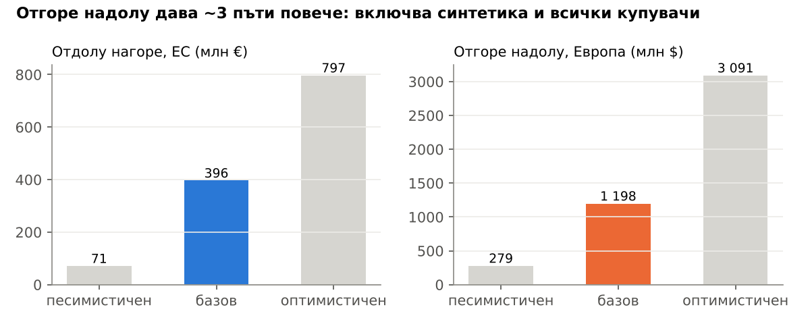
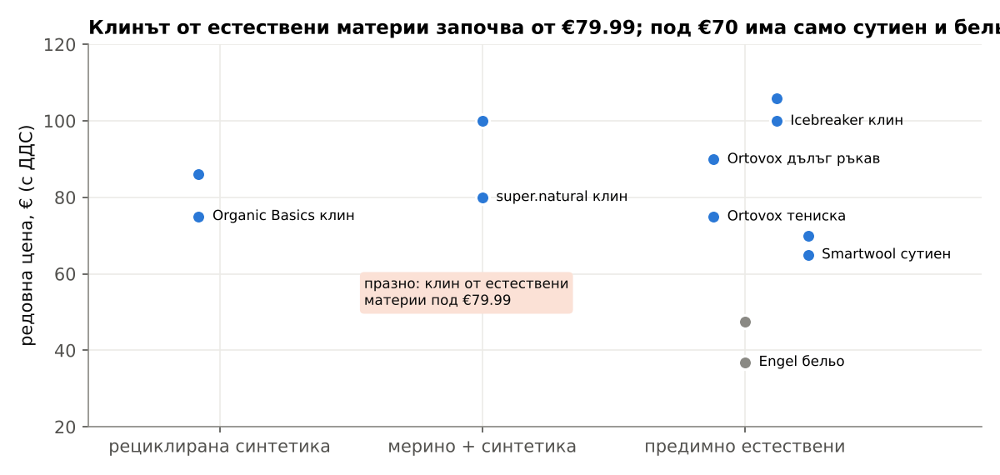
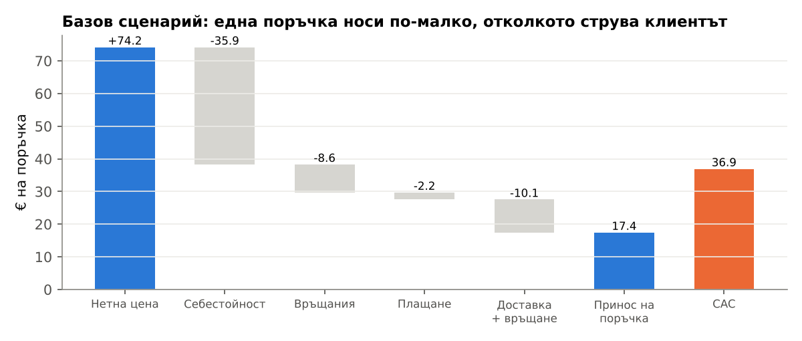
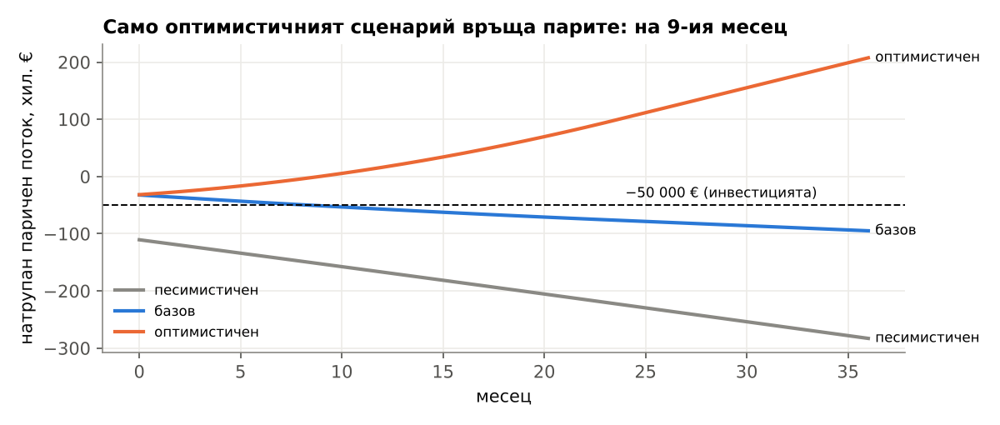
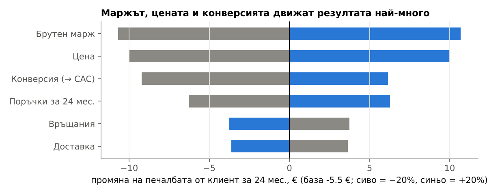

# Да инвестираме ли 50 000 € в сертифицирани спортни облекла без BPA, PFAS и вредни химикали?

*Дата: 30.10.2026 · Пазар: ЕС като начален пазар, глобалният пазар е за сверка · Числата идват от `analysis/research/` (източници) и `analysis/model.py` → `analysis/output/` (сметки). [ОЦЕНКА] означава допускане, а не факт.*

**Присъда: НЕ сега. ДА, само АКО евтин тест покаже, че клиентът струва много по-малко от бенчмарковете.** В базовия сценарий губим €5.55 на всеки клиент: за 24 месеца той носи €31.37 принос, а привличането му струва €36.92. При €2 000 месечен маркетинг [ОЦЕНКА] парите не се връщат за 36 месеца и дефицитът стига €94 929 ([unit_economics.csv](../analysis/output/unit_economics.csv)). Бизнесът покрива и постоянните си разходи само ако CAC е ≤ €19.69. Парите се връщат до 36-ия месец само ако CAC е ≤ €13.09 ([thresholds.csv](../analysis/output/thresholds.csv)).

**Първи евтин тест (2 седмици):** страница с 3 модела [ОЦЕНКА] и предварителна поръчка на клин за €89 [ОЦЕНКА], плюс €600 [ОЦЕНКА] реклами в Meta към жени, които спортуват. Очакваме 855 клика.
- **≥31 поръчки** (конверсия ≥3.62%, CAC ≤ €19.69): продължаваме с малък транш.
- **≥46 поръчки** (конверсия ≥5.38%, CAC ≤ €13.09): влагаме по-голямата част от 50 000 €.
- **По-малко от 31:** спираме.

Типичната конверсия на модни магазини е 1.9%, а при топ 10% е над 6.1% ([05](../analysis/research/05_kanali_cac.md)), така че прагът е висок. Сметката е в [test_2w.csv](../analysis/output/test_2w.csv).

## Ключови числа

| Показател | Стойност | Знаменател / база | Източник |
|---|---|---|---|
| Печалба от клиент за 24 мес. (базов) | −€5.55 | LTV €31.37 − CAC €36.92 | [unit_economics.csv](../analysis/output/unit_economics.csv) |
| CAC за покриване на постоянните разходи | ≤ €19.69 | при €2 000 маркетинг + €1 187 постоянни разходи/мес. | [thresholds.csv](../analysis/output/thresholds.csv) |
| Купувачи в ЕС, които реално плащат премия | 3.15 млн. (0.79–5.51 млн.) [ОЦЕНКА, горна граница] | от 78.7 млн. (450.4 млн. × 38% × 46%) | [market_size.csv](../analysis/output/market_size.csv) |
| Пазар отдолу нагоре, ЕС | €396 млн. (€71–797 млн.) [ОЦЕНКА] | 3 сценария | [market_size.csv](../analysis/output/market_size.csv) |
| Клин от естествени материи при конкурентите | от €79.99 до €105.95 | 4 цени (super.natural, Icebreaker) | [03](../analysis/research/03_konkurenti_ceni.md) |

## 1. Размер на пазара: двата метода се различават около 3 пъти

| Метод | Сметка | Песим. | Базов | Оптим. |
|---|---|---|---|---|
| **Отдолу нагоре (ЕС)** | 450.4 млн. души × 38% спортуват седмично × 46% купуват облекла онлайн × дял, който реално плаща премия (1% / 4% [ОЦЕНКА] / 7%) × поръчки за 12 мес. (1.20 / 1.26 / 1.32 [ОЦЕНКА от 20–32% повторни]) × цена (€75 / €99.90 / €109.52) | €70.9 млн. | €396.4 млн. | €796.7 млн. |
| **Отгоре надолу (Европа)** | глобален пазар на устойчиво спортно облекло ($5.82–14.8 млрд., 4 доклада) × дял на Европа в глобалния пазар на спортни облекла (4.8%–20.9% = $20.62–89.88 млрд. / $430.3 млрд.) | $0.279 млрд. | $1.198 млрд. | $3.091 млрд. |

Източници: [01](../analysis/research/01_razmer_pazar.md), [02](../analysis/research/02_klienti_tarsene.md), [05](../analysis/research/05_kanali_cac.md), [09](../analysis/research/09_oficialni_fakti.md).

**Знаменателят е надценен** [ОЦЕНКА, горна граница]. 38% е делът сред хората на 15+ години, а 46% е делът сред интернет потребителите, но и двата са приложени към цялото население. Липсват броят на хората на 15+ години и делът на интернет потребителите (Евростат demo_pjangroup, isoc_ci_ifp_iu; сайтът е блокиран в тази сесия). Сумите не са превалутирани, защото курсът няма източник.

**Защо двата метода се различават около 3 пъти** ($1.198 млрд. срещу €396 млн., сравнение само по порядък):
1. Сметката отгоре надолу включва **рециклирана синтетика**. Делът на естествените материи **не е намерен**.
2. Отгоре надолу включва и **офлайн продажбите** и всички купувачи, а отдолу нагоре брои само онлайн купувачите, които **реално** плащат премия (1–7%, BCG).
3. „Европа“ в докладите е по-широка от ЕС-27.
4. Отгоре надолу стъпва на платени доклади с непрозрачна методология. Оценките за Европа се различават 4 пъти: от $20.62 до $89.88 млрд.

**Извод:** пазарът (дори ~€0.4 млрд. при горната граница отдолу нагоре) е много по-голям от 50 000 €. Ограничението не е размерът му, а цената за привличане на клиент.

## 2. Клиенти и търсене: казват „да“, но плащат малцина

| Факт | Стойност | Източник |
|---|---|---|
| Готови да платят повече за устойчиви продукти (ЕС) | 59% (72% през 2007); брой анкетирани не е намерен | [EEA](https://www.eea.europa.eu/en/circularity/thematic-metrics/consumer/public-views-on-the-circular-economy) |
| Реално плащат премия за устойчиво облекло | 1–7% от ~19 000 в 8 държави | [BCG чрез Fibre2Fashion](https://fibre2fashion.com/news/apparel-news/apparel-sustainability-important-for-71-of-global-consumers-bcg-283082-newsdetails.htm) |
| Средна заявена премия | 9.7% (>20 000 анкетирани в 31 държави) | [PwC 2024](https://www.pwc.com/gx/en/news-room/press-releases/2024/pwc-2024-voice-of-consumer-survey.html) |
| Не са чували за PFAS (Германия) | 6 от 10 | [BfR 2024](https://www.bfr.bund.de/cm/364/bfr-consumer-monitor-02-2024.pdf) |
| BPA в спортни облекла (тестове в САЩ) | сутиени на 8 марки и тениски на 6 марки (2022); клинове/шорти на 19 марки (2023) | [CEH](https://ceh.org/latest/press-releases/new-testing-shows-high-levels-of-bpa-in-sports-bras-and-athletic-shirts/), [ABC7](https://abc7.com/toxic-chemicals-athletic-wear-brands-watchdog-report-center-for-environmental-health/13267009/) |

## 3. Конкуренти: клинът от естествени материи започва от €79.99; под €70 има само сутиен и бельо

| Марка | Цени (редовни) | Позициониране | Приходи / печалба (публични) | Силни страни | Слаби страни (отзиви) |
|---|---|---|---|---|---|
| Icebreaker | клин €99.90–105.95 | мерино за базов слой и спорт, премиум | купена от VF за US$197.6 млн. при ~US$174.2 млн. приходи (SEC) | марка, ~2K отзива с оценка 4/5 | износване, 15% найлон в „мерино“ |
| Smartwool | сутиен €64.95–69.95 | мерино, на VF | не се отчитат отделно (сегментът Outdoor на VF е US$5 501.4 млн.) | дистрибуция | Trustpilot 1.5 от 118: връщания, обслужване |
| super.natural | клин €79.99–100 | мерино + технически влакна | не е намерено | полиестерът позволява сушилня | 50% полиестер (BASE) |
| Ortovox | тениска €74.90 | мерино за алпинизъм и ски | сегментът Outdoor на Schwan-Stabilo: €245 млн. (2022/23), −14.1% (2023/24) | без PFC (DWR) | издръжливост, гаранция извън ЕС |
| Engel Sports | бельо €36.89–47.50 | вълна + коприна, GOTS | не е намерено | GOTS, най-чист материал | молци, доставка (23 отзива) |
| Houdini | клин €109.52 | шведско кръгово облекло без PFAS от 2018 | не е намерено | без PFAS | най-висока цена |
| Organic Basics | клин €75–86 | рециклиран найлон, TENCEL | не е намерено | цена | синтетика |
| Allbirds (сверка) | – | мерино, предимно обувки | US$189.8 млн. приходи, US$93.3 млн. загуба (2024) | – | активите са продадени за US$39.0 млн. (2026) |

Източници: [03](../analysis/research/03_konkurenti_ceni.md), [07](../analysis/research/07_otzivi_reklami.md), [08](../analysis/research/08_sdelki_mnojiteli.md). Българска марка **не е намерена** в research. Търговският регистър **не е проверен**, защото сайтът е недостъпен от сесията. Пълната таблица е в [Конкурентен анализ.md](Конкурентен%20анализ.md).

## 4. Регулации: „без PFAS“ става задължително, „без BPA“ все още отличава

| Правило | От кога | Източник |
|---|---|---|
| Франция: забрана на PFAS в облекла | 01.01.2026 | [ecologie.gouv.fr](https://www.ecologie.gouv.fr/sites/default/files/documents/20260527_FAQ_decret_PFAS.pdf) |
| Дания: забрана на PFAS в облекла | 01.07.2026 | [SGS](https://www.sgs.com/en/news/2025/09/safeguards-14825-denmark-introduces-national-ban-on-pfas-in-clothing-and-footwear) |
| ЕС: Директива 2024/825, забрана на непотвърдени зелени твърдения | 27.09.2026 | [ЕК](https://circular-cities-and-regions.ec.europa.eu/support-materials/eu-regulations-legislation/directive-eu-2024825-empowering-consumers-green) |
| ЕС: PFHxA (една подгрупа PFAS) в облекла, Регл. 2024/2462 | 10.10.2026 | [B&D](https://www.bdlaw.com/publications/new-eu-pfhxa-limits-take-effect-amid-expanding-pfas-rules-for-apparel-and-textiles/) |
| ЕС: пълно ограничение на PFAS | гласуване ~ началото на 2027 (прогноза) | [EOG](https://www.europeanoutdoorgroup.com/members-knowledge-hub/echa-updates-pfas-restriction-process-and-timelines) |
| ЕС: BPA в текстил | няма ограничение; Германия подаде намерение на 23.04.2026 | [UBA](https://www.umweltbundesamt.de/themen/reach-beschraenkungsdossier-fuer-bisphenole?parent=69322) |
| ЕС: EPR за текстил | схеми до 17.04.2028 | [OEIL](https://oeil.europarl.europa.eu/oeil/en/document-summary?id=1845495) |
| България: специално разрешително за онлайн продажба на облекла | не е намерено | [kik-info](https://kik-info.com/stanovishta-na-nap/7a96aae05e565a87f603d54c308e7d8e) |

Сертификати: годишният лиценз за OEKO-TEX е ~€950, а одитът ~€900 ([Hohenstein](https://www.hohenstein.de/fileadmin/user_upload/Downloads_US/OT/Apply/FAQ_Solicitud_OEKO-TEX_STANDARD_100.pdf)). Марка, която продава готови GOTS продукти, по принцип не се сертифицира сама ([GOTS](https://www.global-standard.org/licensing-and-labelling)).

## 5. Канали и цена за привличане на клиент

| Канал | CAC | Сметка |
|---|---|---|
| Meta, базов | €36.92 | CPM €9.05 / (1000 × CTR 1.29% × конверсия 1.9%) |
| Meta, оптимистичен | €13.87 | CTR 2.25% × конверсия 2.9% |
| Google Search | $98.67 на поръчка (данни за САЩ) | CPC $4.44 / конверсия 4.50% |
| Amazon.de | €13.35 на поръчка | 15% комисиона × €89 (клиентът остава при Amazon) |
| Zalando | €4.45–22.25 на поръчка | 5–25% × €89 (комисиона от 2019) |
| Смесен CAC в облеклата (бенчмарк) | $58 медиана (топ 10%: $34, долни 10%: $112) | 35 марки, Eightx 2025 |

Източници: [05](../analysis/research/05_kanali_cac.md), [cac_by_channel.csv](../analysis/output/cac_by_channel.csv). Нашият CAC за Meta е сглобен от компоненти (CPM от 2026, CTR от 2025, конверсия от 2023) и вероятно е **под** реалния. Бенчмаркът от $58 не е превалутиран.

## 6. Икономика на единица: три сценария

| Показател | Песимистичен | Базов | Оптимистичен |
|---|---|---|---|
| Цена с ДДС [ОЦЕНКА] | €75 | €89 | €99.90 |
| Нетна цена (ДДС 20% [ОЦЕНКА]) | €62.50 | €74.17 | €83.25 |
| Брутен марж (публични компании; за малка марка [ОЦЕНКА]) | 41.0% | 51.6% | 57.6% |
| Връщания | 42% | 22.4% | 20% |
| Доставка на поръчка | €16.49 (DHL) | €8.25 [ОЦЕНКА] | €0 [ОЦЕНКА] |
| Принос на поръчка (след връщания, плащане и доставка) | −€10.43 | €17.43 | €35.96 |
| CAC (Meta) | €43.85 | €36.92 | €13.87 |
| Поръчки за 24 мес. | 1.4 [ОЦЕНКА] | 1.8 | 2.2 [ОЦЕНКА] |
| Стойност на клиента за 12 мес. | −€12.51 | €21.96 | €47.47 |
| Стойност на клиента за 24 мес. | −€14.60 | €31.37 | €79.12 |
| Печалба от клиент за 24 мес. | −€58.45 | −€5.55 | €65.25 |
| Постоянни разходи/мес. (€187 известни + други [ОЦЕНКА]) | €2 187 | €1 187 | €687 |
| Точка на рентабилност (нови клиенти/мес.) | никога | никога | 10.53 |
| Месец, в който парите се връщат | няма за 36 мес. | няма за 36 мес. | 9 |
| Нужен капитал (най-ниска точка за 36 мес.) | €283 054 | €94 929 | €31 768 |

Източник: [unit_economics.csv](../analysis/output/unit_economics.csv); параметрите и източниците им са в [params.csv](../analysis/params.csv).

Метод: маркетингът е €2 000 на месец [ОЦЕНКА], а новите клиенти са бюджетът, разделен на CAC. Повторните поръчки се разпределят равномерно в 23 месеца. Първоначалната стока (3 модела [ОЦЕНКА] × минимална поръчка 300, в песимистичния сценарий 1 000) се плаща в месец 0 и остава като наличност.

## 7. Рискове и какво трябва да е вярно, за да спечелим

**Рискове:**
1. **Регулацията изравнява всички.** „Без PFAS“ е задължително във Франция и Дания от 2026, в ЕС за PFHxA от 10.10.2026, а за всички PFAS вероятно след гласуването в началото на 2027 (раздел 4).
2. **Пропаст между думи и действия.** 59% казват, че биха платили повече, но реално плащат 1–7%.
3. **CAC расте.** Смесеният CAC в DTC търговията е нараснал с 25–40% за 2021–2025 г. ([05](../analysis/research/05_kanali_cac.md)).
4. **Минималните поръчки връзват капитал.** При 1 000 бр. на модел и песимистична цена стоката сама струва €110 625, над 50 000 €.
5. **Сравнимите марки губят стойност.** Allbirds е оценена на ~9.9x приходите при листването, а активите ѝ са продадени за ~0.26x приходите през 2026 ([08](../analysis/research/08_sdelki_mnojiteli.md)).

**Какво трябва да е вярно** (всяко условие е сметнато поотделно, останалото е по базовия сценарий; [thresholds.csv](../analysis/output/thresholds.csv)):

| Условие | Праг | Какво дава |
|---|---|---|
| CAC | ≤ €31.37 | само печалба 0 на клиент; постоянните разходи остават непокрити |
| CAC | ≤ €19.69 | покрива и постоянните разходи в стабилно състояние |
| CAC | ≤ €13.09 | парите се връщат до 36-ия месец |
| Поръчки за 24 мес. (при CAC €36.92) | ≥ 2.12 | печалба 0 на клиент; бенчмаркът е 1.8 |
| Връщания | близо до 22.4% | при 42% приносът пада от €17.43 на €8.31 |
| Брутен марж | ≥ 51.6% | при 41.0% приносът пада на €11.33 |
| Отличие | „без BPA“ + естествени материи, потвърдени с лабораторен тест | „без PFAS“ вече няма да отличава |

## 8. Какво липсва и как да го съберем

| Липсва | Защо е важно | Как |
|---|---|---|
| Реален CAC и конверсия | движат присъдата | двуседмичният тест |
| Себестойност на клин от мерино/TENCEL, шит в BG/PT | маржът е взет от големи компании | 3 оферти от шивашки цехове (БАОТШК, ATP Portugal) |
| Брой хора на 15+ и дял на интернет потребителите в ЕС | коригират знаменателя | Евростат demo_pjangroup, isoc_ci_ifp_iu |
| Дял на естествените материи в пазара | стеснява сметката отгоре надолу | Textile Exchange Materials Market Report |
| Google Trends и реклами на конкурентите | сигнали за търсене | ръчно в браузър (около 1 ч) |
| Търговски регистър | финанси на български играчи | portal.registryagency.bg |
| Официален курс EUR/USD и ДДС | превалутиране и нетна цена | ЕЦБ и lex.bg (блокирани в тази сесия) |

## Проверка

Отчетът е проверен от verifier (вж. [Проверка.md](Проверка.md)). Всички ГРЕШНО и БЕЗ ИЗТОЧНИК от първата проверка са поправени.
